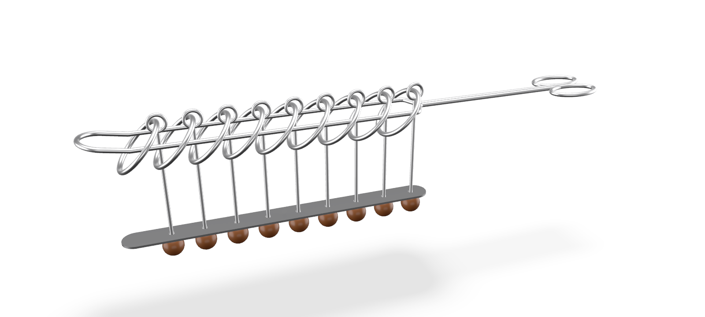

# Nine rings

<picture>
  <source media="(prefers-color-scheme: dark)" srcset="docs/images/toy-dark.png">
  
</picture>

An app for iPhone, iPad and Mac that shows how the Chinese nine linked rings puzzle (the Baguenaudier) works.

The puzzle is old. Nine rings hang on rods from a bar, and a long loop of wire, the sword, runs through them. One rule says which ring can move: ring 1 always can, and any other ring only when the ring just before it is on and every ring before that is off. The shortest way to take all nine off is 341 moves. The app draws the toy in 3D, and lets you make the moves yourself, or watch them, slowly, from any side. You can also set the rings by hand to any of the 512 arrangements: the 512 lie on one line of moves, so each is a real position of the puzzle, and play, undo and solve go on from it.

A lesson goes through the puzzle step by step on the toy, and when it ends, its moves are yours to go on with. The control panel can show how many moves are left to take every ring off. The toy stays as you left it between launches, and every play you finish goes into a history. With iCloud Sync on, both reach your other devices through your own iCloud. If you are signed in to Game Center, the app reports four achievements as you earn them: taking all nine rings off, doing it the shortest way, putting all nine back on, and reaching the far end, where only ring 9 is on.

The app is in English, French, Japanese, and Simplified and Traditional Chinese.

## Written, not simulated

Nothing in the app is simulated. Where every part of the toy is depends only on three things: which rings are on, the move being made, and how far through that move it is. We write the path of the ring that moves as a few smooth curves, and every other part follows from it by rule. The same input always gives the same pose, so a move can be stopped anywhere, dragged either way, and run backwards to put a ring back on.

There are only two written moves. Ring 1 has its own. Every other ring comes off the same way: when ring k may move, ring k−1 and ring k are the first two rings on the sword, as rings 1 and 2 are at the start, so the move written for ring 2 plays for ring k one hole further along.

A checker in the package's tests decides whether a written move is right. It samples each move thousands of times in each direction and holds every pose to the toy's real limits: no two parts closer than 0.2 mm, nothing passing through anything, no two rings linked, a ring leaving the sword only over its tip, no part jumping between samples, and a move that starts and ends at rest without stopping on the way. A move is right when it passes, not when it looks right.

The toy is simplified on purpose. It keeps what explains the mechanism, what passes through what and the stages of a move in the order a person does them, and gives up gravity-true hanging, a swinging bar and the exact lean of each ring.

[docs/motion.md](docs/motion.md) says more: the rules the parts follow, what the geometry forced, and everything the checker checks.

## What's here

- `NineRingsKit/` is a Swift package with everything that does not depend on the screen: the puzzle and its rule, the toy's sizes, the written moves, a puzzle being played, with undo and solve, the rules for the achievements, and the records of the plays, with the rules that keep them on the device and in iCloud. The checker is among its tests.
- `NineRings/` and `NineRings.xcodeproj` are the app, in SwiftUI and RealityKit. It draws the pose the package gives, plays the puzzle, keeps the records with SwiftData and CloudKit, and reports achievements to Game Center.

There are no outside libraries.

## Building

You need Xcode 27.2 or later. Open `NineRings.xcodeproj` and run the `NineRings` scheme on your Mac or in a simulator.

To run the checker, run the package's tests, optimized (unoptimized, they take minutes rather than seconds):

```bash
swift test --package-path NineRingsKit -c release -Xswiftc -enable-testing
```

Every pull request that touches the code runs these tests on GitHub and builds the app for the Mac and for iPhone and iPad. They run again on `main` after each merge.

## Where it stands

The motion is done: every move of the puzzle is written and checked. The app around it is being made ready for the App Store, and is not there yet. What is left is in the [open issues](https://github.com/chentianren0/NineRings/issues).

## Privacy

Nine Rings collects nothing about you: what it keeps stays on your devices and, while iCloud Sync is on, in your own iCloud. Read the [privacy policy](docs/privacy.md).
